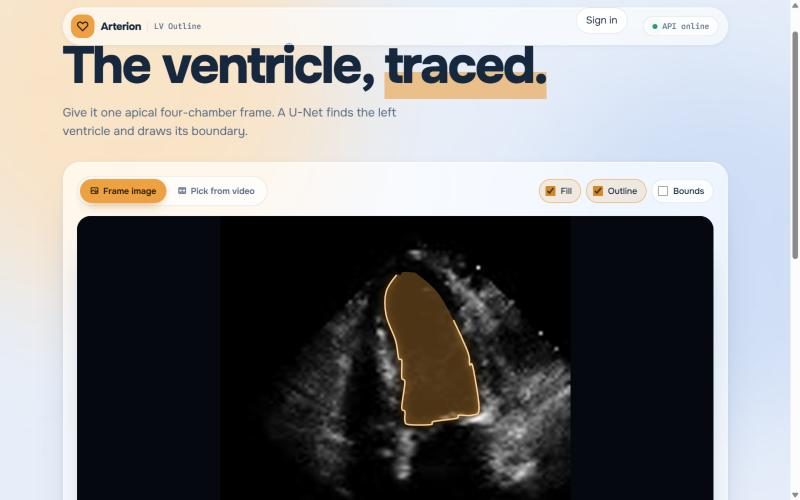

# Arterion LV Outline

[](https://github.com/kartikpagariya25/arterion-lv-outline/actions/workflows/test.yml)  

Traces the **left ventricle** on an apical four-chamber echocardiogram frame: a binary mask, a tinted overlay, and a simplified outline polygon you can feed into volume or ejection-fraction calculations. The site draws the outline with an animated pen stroke and can pick a frame straight from a video.



> **Research prototype — not a medical device.**

Part of the [Arterion](https://github.com/kartikpagariya25/Arterion) project.

## How it works

A ResNet-34 **U-Net** (24.4 M parameters), trained with Dice + focal-Tversky loss on masks rasterised from the EchoNet-Dynamic expert LV tracings (`training/src/build_masks.py`). Input is resized to 112×112, the mask is upsampled with the probabilities (smooth edges) and only the **largest connected region** is kept. The returned `confidence` is the model's mean probability inside the outline.

## Results (EchoNet-Dynamic test split, 2,552 frames)

| Dice | IoU | Precision | Recall |
|---|---|---|---|
| **0.925** | 0.863 | 0.923 | 0.933 |

Evaluated per frame on the end-diastolic / end-systolic frames that carry expert tracings. Trained on one centre's apical four-chamber views; other views, poor acoustic windows or other scanners may fail or trace the wrong cavity.

## Accounts, history and the doctor dashboard

Sign in from the top of the site to keep a history of your LV tracings. Without an account everything still works; results just are not saved.

- **Patients** register with an email and password. Every analysis they run while signed in is saved (the findings, not images or long signals) and listed on `history.html`, together with any note a doctor adds. They can delete single analyses, change their password or delete their account and all of its data.
- **Doctors** get a dashboard on the same page: *Awaiting review*, *All analyses* (filter by type, status or patient), *Patients* and *My analyses*. They open any analysis and write a review note that the patient sees.
- **Doctor sign-up needs an invite code.** Set `DOCTOR_INVITE_CODE` on the backend; with it unset, doctor registration is disabled. To create the first doctor (or reset a forgotten password; there is no email reset):

```bash
cd backend
python -m app.accounts.cli create-user --email doc@example.com --name "Dr Doc" --role doctor
python -m app.accounts.cli set-password --email someone@example.com
```

Under the hood: SQLite, passwords hashed with scrypt, HS256 JWTs, and a lockout after five failed logins per email (15 minutes). See [SECURITY.md](SECURITY.md) for what this does and does not protect.

| Setting | Default | Meaning |
|---|---|---|
| `DATA_DIR` | `backend/data` (a Docker volume in compose) | where `arterion.db` and the generated JWT secret live |
| `JWT_SECRET` | generated once, kept in `DATA_DIR` | signing key; set it to share tokens between replicas |
| `JWT_EXPIRE_MINUTES` | `480` | token lifetime |
| `DOCTOR_INVITE_CODE` | empty (doctor sign-up off) | code required to register as a doctor |
| `REQUIRE_AUTH` | off | `1` makes every endpoint, uploads included, require a signed-in user |

| Endpoint | Who | Purpose |
|---|---|---|
| `POST /auth/register`, `POST /auth/login` | anyone | create an account / get a token |
| `GET /auth/me`, `POST /auth/password`, `DELETE /auth/me` | signed in | profile, change password, delete account and data |
| `GET /history`, `GET /history/{id}`, `DELETE /history/{id}` | signed in | the caller's own saved analyses |
| `GET /doctor/patients`, `GET /doctor/analyses[/{id}]` | doctor | all patients and their analyses |
| `POST /doctor/analyses/{id}/review` | doctor | add or update a review note |

Prediction endpoints take an optional `Authorization: Bearer <token>`; when present the result is saved and the response carries an `X-History-Id` header.

## Design

The site follows one landing-page system: a floating navigation (logo mark, centre pills, sign-in, Get Started), a hero with a serif headline and an italic gradient second line, six feature cards, a four-step process, the working tool, a dark evidence section with the real held-out metrics, a call to action and a footer.

- **Palette:** sky blue and white. Tokens live in `frontend/css/theme.css`.
- **Type:** Lora for headlines, Manrope for text, JetBrains Mono for numbers.
- **Motion:** GSAP ScrollTrigger drives scroll progress, reveals, the rail that connects the steps and the metric bars. Motion (the vanilla build of the Framer Motion engine) drives the hero entrance, button springs and count-ups. Everything collapses to a static page under `prefers-reduced-motion`.
- **Details:** see [DESIGN.md](DESIGN.md).

## Run it

```bash
./scripts/fetch_weights.sh        # or .\scripts\fetch_weights.ps1  (GitHub Release)
docker compose up --build
# site: http://localhost:8080     API docs: http://localhost:8000/docs
```

Without Docker: `cd backend && pip install -r requirements-dev.txt && uvicorn app.main:app --port 8000`, then serve `frontend/`. The site talks to `window.API_BASE` (`frontend/js/config.js`). No sample images are bundled: the EchoNet-Dynamic data-use terms do not allow redistributing its frames.

### API

| Endpoint | Body | Returns |
|---|---|---|
| `POST /uploads` | multipart `file` | `{file_url}` |
| `POST /lv-outline/predict` | `{file_url}` (image) | `original_image_base64`, `overlay_image_base64`, `mask_base64`, `contour` (normalised polygon), `area_fraction`, `confidence`, `width`, `height` |

Small frames are upscaled to 448 px for display and large ones capped at 640 px. Non-images return 422; a frame with no ventricle returns an empty contour and a clear summary.

Tests: `cd backend && pytest tests`.

## Training

`training/src`: `build_masks.py` → `train.py` → `evaluate.py` → `export_onnx.py` → `infer.py`. The network (`unet.py`) and loss (`losses.py`) are self-contained in this repo.

## Documentation

- [Model card](MODEL_CARD.md): data, results and limitations
- [Changelog](CHANGELOG.md)
- No Docker? Run `scripts/run_local.ps1` (Windows) or `scripts/run_local.sh` (macOS/Linux); it creates a virtual environment, starts the API on 8000 and the site on 8080. Needs Python 3.11.
- [Contributing](CONTRIBUTING.md)
- [Security and privacy](SECURITY.md)

## Data and licences

Code: MIT. Trained on [EchoNet-Dynamic](https://echonet.github.io/dynamic/) (Ouyang et al., *Nature* 2020), which is released under the Stanford University Dataset Research Use Agreement — non-commercial research use only. Check those terms before using the trained weights outside research.
